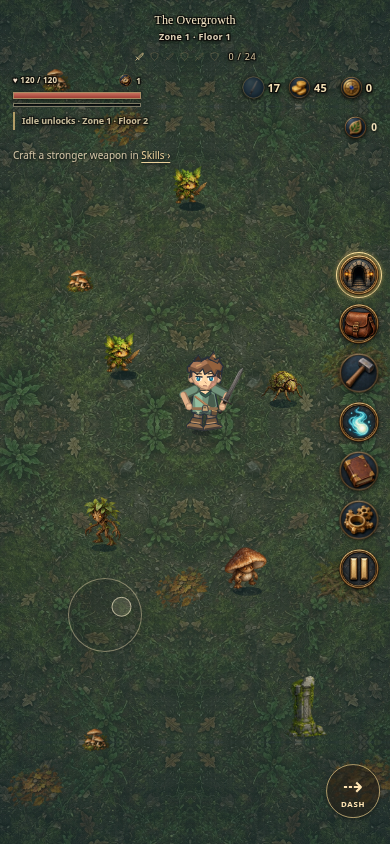

# Idle or Dungeoneer

**[Play in your browser](https://mefforts.github.io/idleordungeoneer/)** · **[Download the latest game (ZIP)](https://github.com/mefforts/idleordungeoneer/raw/refs/heads/main/downloads/Idle_or_Dungeoneer_Latest.zip)** — extract it and open `index.html` in a modern browser.

The game, environments, creatures, equipment and icons are embedded in one HTML file. The downloaded build needs no installation or internet connection. `npm start` serves it locally if you prefer a consistent browser save origin.

**Build 11.2.1** fixes purchased game-time controls: the Speed button stays available in every scene after either purchase, with separate **Delving** and **Skilling (including idle)** selectors containing every unlocked rate. Both selections survive reload, and code-unlocked testing multipliers remain available alongside them. [Phone controls](preview-purchased-speed-mobile.png) · [Landscape controls](preview-speed-controls-landscape.png).

Skilling uses calmer work loops with a visual tempo cap at **4×**. Higher rates add sparks, then short bursts at **10×** and small fireworks at **24×**, while production keeps the chosen speed. Visible rarity names are removed from pickups, popups and active buffs; colors, effects and remaining time stay clear. [Phone skilling](preview-skilling-speed-mobile.png) · [Tempo comparison](preview-skilling-tempo.mp4).

**Build 11.2.0** gives elite and guardian abilities illustrated appearances alongside their warning glows: roots and thorns, molten eruptions, skeletal hands, crystal ruptures, growing stars, returning blades, chains, shield emblems and summoning portals. Effects animate through preparation and impact, pause with combat and have steady reduced-motion appearances. Colored threat boundaries and safe spaces stay readable. [Appearance comparison](preview-ability-effects.png) · [Animation reel](preview-ability-effects.mp4) · [Phone eruptions](preview-ability-eruption-mobile.png).

Totem beams now keep a consistent purpose color: **green crosses for healing**, **red swords for damage**, with **blue chevrons assigned to the attack-speed palette**. Current enemies still use their existing healing, damage and summoning mechanics. Streams keep their purpose color when intercepted, gain a teal recipient ring, and become muted when disabled. [Both streams on phone](preview-totem-beams-mobile.png).

**Build 11.1.1** fixes crossing arms during skilling: the supporting palm stays behind the nearer forearm, with both grips on the tool handle. The correction applies through regular work, bonus flourishes and both facings. [Crossing close-ups](preview-arm-crossings.png) · [Updated animation reel](preview-skilling-upgrade.mp4).

When a stronger speed bonus is already active on the same activity, a weaker pickup now becomes **1–5 of that activity’s output instantly**, including refined materials. The pickup shows the item and quantity before collection. These are free bonus items; normal crafts retain their recipe costs. Equal pickups refresh speed and stronger ones improve it, while an instant reward leaves the active timer untouched. [Phone windfall](preview-skilling-windfall-mobile.png).

**Build 11.1.0** upgrades the eight skilling animation families with distinct strike rhythms, subtle cycle variations, contact sparks/chips and two collection flourishes per family. Refining discoveries now grant timed crafting speed instead of a one-off progress jump. [Phone refining](preview-skilling-bonuses-mobile.png) · [Phone gathering](preview-skilling-gathering-mobile.png) · [Animation and bonus capture reel](preview-skilling-upgrade.mp4) · [Collection poses](preview-skilling-flourishes.png).

| Discovery | Chance | Active speed | Working time |
| --- | ---: | ---: | ---: |
| Common | 65% | +35% | 6s |
| Uncommon | 24% | +50% | 8s |
| Rare | 9% | +75% | 10s |
| Very rare | 2% | 2× | 15s |

Pickups show their rarity, speed and duration; an active chip shows the remaining time and opens details. The strongest boost applies, and collecting the same rarity refreshes it. Weaker pickups instead grant 1–5 output items instantly. Timers count real seconds of active work on the matching activity, pause on release, missing ingredients, menus or backgrounding, and survive reloads. These temporary boosts apply to active work; permanent Skilling speed still includes online/offline idling. Gathering pickups also retain their material reward, and every accelerated craft consumes its ingredients.

Melee helms reveal the face through the **original T-shaped cutout**. Cohesive chests use one centered breastplate, softer leather shading and centered robe collars. The previous closed-helm art and downloadable build remain preserved at [v11.0.2](https://github.com/mefforts/idleordungeoneer/tree/b3b03755ab730dbfbbb2e21a746bce9689a0f90a).

**Build 11.0.2** gives Iron and Steel armor enclosed full helms with narrow visors and red plumes. Ranger leathers now have slimmer, open-faced caps with a single pale feather. Combat, skilling, Appearance, Inventory and Codex use the same headwear. [Compare both tiers](preview-headwear.png) · [Phone full helm](preview-full-helm-mobile.png) · [Phone ranger cap](preview-ranger-cap-mobile.png) · [Phone Inventory](preview-headwear-inventory-mobile.png).

**Build 11.0.1** replaces the Mage hoods with small wizard hats: a folded point, broad brim and stitched arcane star, in linen cream or blue to match the robes. The same hats appear in combat, skilling, Inventory and Codex portraits. [Both robe sets](preview-wizard-hats.png) · [Phone Warding](preview-wizard-hat-warding-mobile.png) · [Phone Inventory](preview-wizard-hat-inventory-mobile.png).

**Build 11.0** adds a meaningful first game-time choice, clearer preparation, and visible monster loot. [Time choices](preview-game-time-mobile.png) · [Preparation route](preview-preparation-mobile.png) · [Loot and active buffs](preview-loot-buffs-mobile.png).

Reach **Zone 2** for your first Dungeoneering level and point, then **Zones 5, 10, 20, 40…** for the next points. In the Dungeon Shop, spend one point per rank on **Delving: 1.25×, 1.5×, 1.75×, 2×, 2.25×…** or **Skilling: 2×, 3×…10×, 12×, 14×…24×…**. Skilling includes gathering, crafting, online idling and offline idling. The eight initial combat perks still use Dungeon Sigils and remain available from the start.

Monster rewards now show actual gold, Sigils, essence and rare raw-material bundles, with recent loot readable in Inventory. Ordinary / elite / boss material chances are **1.5% / 8% / 18%**, for **1 / 3 / 6** items; material income supplements skilling. Guardians can drop tiered refinement vouchers on their first defeat (**6%**, or **15%** for a Zone-final overlord). Redeem one explicitly at Skills → Equipment for an eligible weapon refinement. The Scholar Ring now improves material drop chance, and Plentiful Hunt boosts the capped material chance.

Temporary buffs have a visible combat strip with countdowns, stack counts and next expiry; tap a buff for every stack's remaining time. Combat instructions fade and recur while warning shapes remain visible. **Double tap while moving on mobile to dash**: keep moving with one finger and double tap with another, or use two quick directional drags. Space, the Dash button and keyboard triple-taps remain available.

Ammunition descriptions consistently show ten seconds per arrow/rune. Recipe cards explain weapon roles, and a five-minute supply action opens a tracked preparation route. The existing tracker now plans shared ingredients, batches and remaining Iron refinements for Steel promotion, while keeping Zone access, skill training, refinement and optional armor distinct.

Repeated upgrade preparation costs less gold: the full Iron refinement/speed curve is **785** instead of 1,485; Steel is **1,885** instead of 3,050; promotion is **100** instead of 150. Successful weapon crafting, refinement, speed training and promotion train the matching discipline. Material requirements remain. Existing saves receive the price difference for owned ranks/promotions as a one-time gold credit, recorded in Settings → Messages. [Preparation comparisons](PREPARATION.md) explain the routes and timing limits. Existing saves retain balances, equipment, allocations, earlier combat-perk unlocks and the old 2× Delving entitlement.

**Build 10.1** lets you break summoning spires by walking into them: **one bump normally, two for a crowned spire**. Step clear between hits. Teal is safe; red means a summoning surge that can hurt you. Dash through it or wait for teal to avoid retaliation. Weapons still work, and the label above each spire shows the remaining bumps. [Phone preview](preview-spire-collisions-mobile.png) · [Collision demo](preview-spire-collisions.mp4) · [Looping preview](preview-spire-collisions.gif).

**Build 10.0.2** fixes skilling arms that looked detached from the shirt. Working and reaching arms now keep a continuous shoulder-to-wrist outline across all eight work families. [Phone mining](preview-player-mining-mobile.png) · [Phone warding](preview-player-warding-mobile.png) · [Work loops](preview-player-work-loops.gif).

**Build 10.0.1** protects gameplay holds from Safari text selection, highlighting and Copy/Look Up callouts. Mining and touch movement continue while held; releasing, cancelling or losing pointer capture stops them. Menus retain scrolling, keyboard controls and editable/save controls retain native behavior.

A lightweight loading screen appears before the embedded assets arrive and hands over to the intro when the first scene is ready. It supports reduced motion and offers retry if startup fails. [Phone preview](preview-loading-mobile.png) · [Desktop preview](preview-loading.png).

For iPhone and iPad, enable **Settings → Pages → Deploy from a branch → main → /(root)**, then open **https://mefforts.github.io/idleordungeoneer/** in Safari. Use **Share → Add to Home Screen** for a game icon. The root `.nojekyll` marker serves the standalone game without Jekyll processing. The first Pages deployment must finish before the URL works; its result appears under **Actions → pages build and deployment**. Use the in-game save backup/restore when moving between downloaded files and the website.



[Inventory](preview-inventory-mobile.png) · [Materials](preview-inventory-materials.png) · [Dungeon Shop](preview-dungeon-shop-mobile.png) · [Intro](preview-intro-mobile.png) · [Counterplay themes](preview-encounter-themes.png) · [Healing stream](preview-totems.png) · [Phone elite group](preview-encounters-mobile.png) · [Floor progression](preview-floor-progression.png) · [Phone environment](preview-environments-mobile.png) · [Desktop Dungeon Shop](preview-dungeon-shop.png) · [Skills](polish-mobile-gather.png) · [Codex](polish-reading.png)

## Dungeon Shop

**Build 10.0** replaces separate Zone shops with a shared **Dungeon Shop**. All current Zones belong to **The First Descent**; a future Dungeon can have its own wallet and perks. Open the wisp, the Dungeon Sigil counter or **B**. Purchased ranks remain active throughout this Dungeon.

Eight combat perks start unlocked: Ember Edge, Winter Thread, Soul Conductor, Fracture, Dungeon Ward, Battle Geometry, Echo Arts and Spellbreaker. Cold Verdict, Returning Power, Gravitation and Mirrorcraft unlock at Dungeoneering **3 / 5 / 8 / 12**. First ranks cost 6–26 Sigils; subsequent ranks cost 2.8× more, rounded upward.

Every purchase benefits **Melee, Mage and Ranged**. Some perks change with the equipped weapon, as the shop explains:

| Shared purchase | Melee | Mage | Ranged |
| --- | --- | --- | --- |
| Battle Geometry | More sweep targets and reach | Elite-first homing | Piercing arrows |
| Echo Arts | Weak echo blade | Spell ricochets | Additional arrows |
| Returning Power | Returning slash | Returning orb | Returning arrow |

Dungeon Sigils arrive slowly: ordinary monsters have a **0.3% chance of one**, other elites **35%**, and rares guarantee **one**. Guardians grant **1 / 1 / 2**, with **3 more** from a Zone-final overlord. Summoned creatures grant no rewards. Fortune 4 raises the ordinary chance to **0.42%**. Jewelry and equipment retain traditional statistics; the shop focuses on elemental effects, area attacks and utility.

Old Zone wallets and the full historical price of purchased ranks convert once at **25 seals per Dungeon Sigil**, retaining fractional credit. Original ledgers stay archived in the save. Choose new perks freely.

**Dungeoneering starts at level 0.** Reaching Zones 2, 5, 10, 20, 40 and so on grants one level and one shared point. Replays grant no extra points. Spend the first point on one of the two game-time paths in the Dungeon Shop; additional optional Mastery allocations share that bank. Permanent time ranks are retained when allocations are refunded. Combat XP and old ground caches are preserved as a historical ledger, with no new visible XP drops. These milestone rules do not add new Zone content.

Press **Delve while delving** to replay a cleared floor or return to the frontier. The first idle-slot tip explains that the second slot comes at **Zone 2**. Entering Zone 2 also explains replay travel and the second idle slot. Crafting your first upgraded weapon gives a refinement and Warding enchantment tip.

[Phone shop](preview-dungeon-shop-mobile.png) · [Desktop shop](preview-dungeon-shop.png).

## Equipment and pacing

| Build | Zone 1 / Iron | Zone 2 / Steel |
| --- | ---: | ---: |
| Maximum equipment, base proficiency | 80 DPS | 160 DPS |
| Dedicated equipment training | ~86 DPS | ~173 DPS |
| Single-target soft budget | 100 DPS | 200 DPS |

Weapon refinement, attack-speed training, proficiency and matching crafting levels provide core damage. Above the Zone’s single-target budget, each extra calculated DPS contributes at 25%; real hit damage uses the same adjustment. Conditional elemental damage and additional targets can add more. Abilities have finite ranks and increasingly expensive prices.

| Zone | Target at 1× | Reference DPS |
| --- | --- | ---: |
| 1 | ~10 minutes | ~80 |
| 2 | ~20 minutes | ~160 |
| 3 | ~30 minutes | Current Steel reference |
| 4+ | ~35–40 minutes | Current Steel reference |

References use complete Iron / Steel equipment at base proficiency, with no required Dungeon abilities. Movement, menus, deaths, preparation, cleaves and speed settings affect real completion time. [BALANCE.md](BALANCE.md) explains the paths, rank costs and live simulations; [balance-report.json](balance-report.json) includes exact weapon, shop and economy values. Later equipment progression remains reserved.

Ordinary monsters drop **no gold**. Baseline clears pay **191 gold in Zone 1 / 293 in Zone 2**, mainly from guardians and floor caches, before elites and jewelry. Those per-Zone gold budgets stay the same across the longer floor counts; guardian XP is also spread across each Zone. Scavenging remains another gold source. Fractional rewards survive reload; existing balances and crafting costs are preserved.

## Zone scenery and creatures

The four authored Zones now contain **168 scenery, terrain and creature assets**. There are **42 ordinary creature forms and 42 matching rare elites**. The first pass added 72 environment illustrations; the new creature passes add 60 more illustrations, alongside four new medallions.

| Zone | Floors | Ordinary forms | Rare elites |
| --- | ---: | ---: | ---: |
| The Overgrowth | 5 | 8 | 8 |
| Embervault | 10 | 10 | 10 |
| Hollow Crypt | 20 | 12 | 12 |
| Astral Rift | 20 | 12 | 12 |

Each area also keeps its twelve scenery objects, three guardian forms, three terrain textures and three ground details. New families join the spawn mix gradually as you descend. Floor names, layouts and creature mixes change throughout all **55 named floors**.

Each floor changes the terrain, scenery mix and regular-creature mix gradually. Overgrowth moves from woodland to rooted ruins and the Elder Grove; Embervault from ash to the foundry and molten heart; the Crypt from graves to vaults and the Sovereign’s sanctum; the Rift from fractured approaches to starlit ruins and the Unmade threshold. Ground litter groups around larger landmarks, and starting areas retain open walking space. Later Zones that repeat a biome receive their own seeded layout.

New creatures scuttle, sway, hop, prowl or hover, with reduced-motion support. Their appearance does not change wave health, speed, rewards or boss mechanics. Scenery uses foot-level collision and fades when it would hide the player or nearby enemies. Ground details stay beneath characters and telegraphs. Zone Codex pages list the floors and creatures.

[Compare early, middle and final floors](preview-floor-progression.png). Source sheets, sprite-isolation metrics and the asset catalog are in `assets/environments/`. `npm run art:environments` exports transparent WebP cutouts and terrain textures into `src/environment-art.js`; `npm run review:environments` captures the actual game renderer. Runtime placement, floor palettes and creature animation are in `src/environments.js`.

## Minimal runestone interface

Gameplay uses outlined information and isolated controls with transparent backing. Delve, Inventory, Skills, Dungeon Shop, Codex, Settings, Pause and unlocked speed occupy a circular icon rail. The dungeon entrance, satchel, wisp and raised play/pause medallions use over 90% of each button’s space. **Settings → Navigation** selects either side and reorders pins with dragging or arrows. Titles sit at the top center, health and Dungeoneering on the left, and warnings/messages below them. The message icon reopens the latest 40 notices.

Menus use warm stone, leather and brass. Carved runestone buttons and headers keep hard corners; painted medallions frame the icons. Collection entries and guides have distinct artwork. Tooltips, native buttons, focus restoration and accessible labels support keyboard and touch navigation. Detailed explanations stay in the Codex.

**Inventory** shows the worn set, actual Zone DPS, health, attack speed and reach. Touch anywhere on a weapon’s main card or an owned armor card to equip it; the separate book button opens details. Weapons, armor, jewelry and materials have their own tabs. Materials show live quantities and link to their source; style training expands when needed. Books return you to the same recipe, shop, search or unapplied Mastery allocation.

## Gathering and crafting

Scavenging cards show their gold yield alongside fragments or salvage. Each search gives a visible material-and-coin receipt, and gold recipe costs lead directly to Scavenging. Work surfaces, hand tools and separate head/torso/arm joints keep each activity grounded; kneeling searches, hammer strikes, knife carving, woven cloth, rune tracing and gem cutting have distinct motion. Warding effects follow the current Zone’s palette. [Scavenging](preview-scavenging-mobile.png) · [Gold rewards](preview-skilling-rewards.png) · [Warding](preview-warding.png) · [Armor poses](preview-workshop-poses.png).

A small link below the idle-unlock notice guides new players to craft a stronger weapon. It stays until their first weapon craft or refinement, then remains dismissed across reloads.

**Skills** organizes each discipline into Gather, Refine, Equipment and Tools. Hold the work control, scene or Space. Active material bonuses can be tapped, dragged over, or collected with Enter/Space while focused. Forge sparks, twigs, glistens and similar discoveries grant **timed active speed**, from +35% for 6 working seconds to double speed for 15 working seconds, while still consuming ingredients. A second finger can collect bonuses while the first keeps working.

Resource costs link to their sources, and tracked recipes follow you back to the crafting bench. Every skill hub and activity has a direct **Idle** button. With one slot, choosing another task switches it immediately. With two slots, an empty slot is used first; if both are occupied, choose which task to replace without stopping it first. The first slot unlocks at **Zone 1, Floor 2**, with a notice linking directly to Skills. The second opens when you clear Zone 1 and enter Zone 2. Assigned tasks continue during combat and menus, with up to eight hours offline; missing ingredients pause refining.

Crafted pickaxes, hatchets and mattocks equip automatically, appear in gathering scenes, work **8% faster actively**, and add one material to gathering bonuses. Each station has five upgrades, each granting **2% ingredient conservation and 3% work speed**. Conservation carries between crafts until it saves a whole ingredient; viewing costs never consumes that credit.

Clear Zone 1 to unlock the second resource tier in every discipline. The gate applies to active, idle and offline work, armor recipes and promotions.

| Discipline | Zone 2 gathering / refining |
| --- | --- |
| Blacksmithing | Coal; 2 Iron Ore + 1 Coal → 1 Steel Bar |
| Woodworking | Willow; 2 Willow + 1 Steel Bar → 12 arrows |
| Scavenging | Ancient Salvage; 2 salvage → 2 Ancient Fragments |
| Warding | 2 Warded Cloth + 1 Willow → 2 Runic Cloth; 2 cloth + 2 fragments → 10 runes |
| Artisan | Rough Garnet → Cut Garnet |

All 20 activities support their appropriate scenes, active bonuses and visible tools. Existing starter recipes cross disciplines too: arrows use oak and iron; runes use cloth and fragments; armor uses different proportions of cloth, metal and wood. Existing opal jewelry remains available.

## Weapons and armor

Each arrow supplies **10 seconds of bow firing time**, and each rune **10 seconds of staff casting time**. Loaded time stays while waiting for a target, paused, skilling or using the other weapon, and survives reloads. Delve speed scales this combat clock. The HUD shows reserve items and total firing time beside the Sigil counter; its details include loaded seconds. Low supplies are marked and link to preparation. [Phone HUD](preview-ammunition-mobile.png).

One weapon selects your Melee, Ranged or Mage style. Each style has separate refinement, speed, reach, enchantment and proficiency. Iron caps at refinement **10**, speed/reach **5**, reinforcement **5** and enchantment **2**. Steel caps at **20 / 10 / 10 / 4**. Clear Zone 1, reach refinement 10 and crafting level 10, then pay a Steel promotion to open the next ranks for that style.

Combat proficiency grants up to **3% damage** and matching crafting levels up to **5%** more. Equipment-only dedicated limits are approximately **86 / 173 DPS**. Zone elemental upgrades work with every combat style.

The Opal Leech Ring starts at **0.5%** lifesteal. Armor equips independently of the weapon. Melee, Ranged and Mage each have two illustrated sets: Iron/Steel armor, Plain/Cured leathers, and Linen/Blue Wool robes. The worn set supplies its own health and protection, movement or Mage bonus. Reinforcement adds 8 HP per rank, limited by that set’s tier. Switching owned armor never heals you. Promotions change held weapon art; bows aim toward targets while retreating, and articulated hands, collars and weapon grips stay joined across poses.

## Player and animation

The player has a compact, illustrated 2D style: expressive faces, crisp outlines, simple shading and plain starter clothing. **42 vector parts** cover travel clothes and the six existing armor sets, with independent head, shoulder, chest, leg, boot and glove attachments. Arms and legs have continuous outlines across their joints. Near and far arms use separate layers, with inward-facing thumbs and forearms that can cross the chest. The eight work tools include a weaving shuttle and jeweler’s chisel; weapon art keeps its existing detail.

The same rig serves combat, gathering, crafting, appearance previews and inventory portraits. Relaxed hands rest below the waist; combat has distinct ready stances and two-handed tools and weapons share calibrated grips. Work has continuous anticipation, strikes and recovery, plus distinct carving, weaving, engraving, gem working and kneeling searches. Starting and stopping blend smoothly. Saved appearance choices retain their colors and styles. [Outfits](preview-player-sets.png) · [Motion phases](preview-player-actions.png) · [Mining on phone](preview-player-mining-mobile.png) · [Weaving](preview-player-warding.png) · [Animation recording](preview-player-motion.webm). [CHARACTER_ART.md](CHARACTER_ART.md) describes the assets and attachment system.

Attack clips now ease into windup and return to their ready stance, including a continuous bow release. Working elbows bend below raised hands, and the tool arcs clear the head. Carving, rune engraving and gem work use larger, distinct gestures; their tools meet the workpiece and sparks appear on contact. Weaving passes the shuttle across the cloth, and scavenging uses a planted support palm with a lift-and-rake cycle. Solid workpieces sit behind the fingers. Appearance plays complete attack cycles.

[Motion reel](preview-player-motion-overview.mp4) · [Live work scenes](preview-player-live-skills.mp4) · [Animated work loops](preview-player-work-loops.gif). These recordings show the current renderer at 1× animation speed. The close-up reel covers movement, all six weapon families and all eight work families; the scene reel includes starting and releasing work.

## Guardians and elites

The combat library now has **28 attack patterns**, including eighteen new ones. Bosses change tactics at **75% and 40% health**, with shielded Royal Guards, summoning spires, failed-reflect healing, and large arena attacks. Their body hurtboxes now match their visible size, so a short sword can hit a large creature above its feet.

| Warning | Meaning |
| --- | --- |
| **Red** | Dangerous to you only |
| **Violet** | Dangerous to you and other monsters |
| **Gold / white center** | Stand in the center to reflect |
| **Teal** | Safe space or an intercepted benefit |
| **Blue** | Shield; remove its source or Royal Guards |

Shapes, outlines and labels reinforce the colors. Violet sweeps, charges, beams, eruptions and rebounding rings also damage other enemies once per cast: **35% ordinary / 12% elite / 2.5% boss maximum HP**, before shields. They cannot trigger player weapon procs or lifesteal.

- **Rebounding Barrage** fires three projectile rings with rotating gaps, then banks them off the arena bounds. **Growing Stars** expand as they travel. **Homeward Blades** turn back toward their caster.
- **Threefold Ruin** warns three red arena quarters and marks one teal quarter safe. Numbered lanes, inner/outer rings, pincers, spirals, mines, siphon tethers and orbital blades provide other movement challenges.
- **Royal Guard** protects the boss with a blue shield until its guards are defeated. The boss takes 70% less damage while protected.
- **Hungry Mirror** returns 12% maximum boss HP and staggers when reflected; a missed center heals the boss for 5%. Standard reflects retain their 1.9s warning.
- **Calling Spires** replenish ordinary monsters or elites after visible arrival warnings. Walk into a normal spire once, or a crowned spire twice, stepping away between bumps. Teal is safe; a red, surging spire retaliates for **8% / 12% maximum HP before defenses**. Dash through or wait for teal to avoid that damage. Weapons can also damage them. Breaking a spire cancels its pending arrival; existing minions stay. Summons and spires grant no loot, XP, Mastery or wave progress; encounter caps prevent unlimited armies.
- **Healing and power totems** remain untargetable. Get closer to the totem than its caster to redirect the stream. They stay until the caster falls. Power interception grants +10% hit damage for five seconds; healing now has a finite reserve.

Reflect centers, stream corridors and totems retain their larger spacing and scenery checks. Major arena attacks and reflects reserve clear cast windows. Owner death, retry, defeat and transitions clean up the caster's mechanics. Menus and skilling pause combat timers.

Known guardians still return as elite echoes, up to **one / two / three per wave** as floors deepen. They can charge, ricochet, shield allies and use additional themed patterns. Shield sources cannot form shield chains.

[Safe-quarter warning](preview-boss-sunder-mobile.png) · [Summoning spire](preview-summoning-spire.png) · [Combat reel](preview-boss-patterns.mp4).

## Rare elites and blessings

All **42 ordinary creature forms** have a distinct painted rare elite form with **3.5× health**. Eligible spawns have a **1.5% chance**, capped at one rare per wave. Rares always leave blessing spoils; other elites leave them **35%** of the time.

**Walk over spoils** to pause the delve and see three A/B/C options. Touch/click a card or press **1 / 2 / 3**. Movement and Escape cannot choose or dismiss the screen. **Skip blessing** explicitly discards that drop. Choice contents are fixed when dropped and survive reload.

The ten blessings last **40–60 seconds**: Battle Fervor, Windstep, Stonebreaker, Totem Silence, Stillworld, Golden Hunt, Plentiful Hunt, Chain Reaction, Momentum and Long Reach. They add offense or powerful utility: disabling totems, halving enemy movement, granting gold or improving rare material chances. There are no healing blessings.

**Different blessings and repeated copies stack**, with independent timers and visible stack counts. Menus, pause and skilling freeze their duration. They carry across Zones in this Dungeon. Unclaimed spoils stay in their original Zone. Delve speed advances combat time.

The Opal Leech Ring remains at **0.5%** of actual direct-hit health removed, with no overkill healing.

[Phone choices](preview-blessings-mobile.png) · [Landscape choices](preview-blessings-landscape.png).

## Healing drops

Ordinary monsters have a **2% chance** of a mote healing **3% maximum HP**. Other elites have a **55% chance** of **12%**, and rares a **70% chance** of **15%**. Motes wait at full health and stay through waves on the same floor; starting or retrying clears them.

An intercepted healing stream restores **0.35% maximum HP per second**, up to a **15% lifetime reserve per totem**. A depleted stream still blocks the caster's healing. Uninterrupted streams restore **0.4% caster maximum HP per second**. Healing streams do not stack.

## Controls and saves

| Action | Controls |
| --- | --- |
| Move | Touch anywhere in the arena and drag; release to stop. WASD/arrows and mouse also work |
| Dash | Double tap with another finger while moving, two quick directional drags, triple tap a movement key, Space or Dash |
| Break summoning spire | Walk into it; crowned spires need two bumps with a step away between hits. Dash or wait while red |
| Work | Hold work control, scene or Space |
| Collect active bonus | Tap, drag, Enter/Space on focused bonus |
| Skills / Inventory / Codex / Dungeon Shop | G / E / C / B |
| Return to delve | D or Delve pin |
| Close menu / pause | Escape |

Older three-floor saves migrate to the expanded depths once. Previously reached Zones, equipment, wallets, materials, Dungeoneering XP, Mastery and idle assignments are preserved. Former Zone completions mark the expanded Zone as cleared, so the new intermediate floors can be replayed. Saves retain the `deepwell-prototype-v1` key. Settings provides backup/restore and reduced motion. Back up and restore your save when moving between browser origins or downloaded filenames.

Existing power ranks and pending choices pass through the legacy Zone migration, then convert into Dungeon Sigils. Earned XP becomes historical global XP; old uncollected orbs are banked once. Old biome Mastery banks are pooled; duplicate allocations are refunded. Migration runs once and archives the old Zone/Mastery record. Equipment, materials, gold and XP caches remain. Older excess equipment ranks and unavailable armor remain archived under the existing tier rules.

## Development and validation

Builds are committed to GitHub with the standalone ZIP in `downloads/`. [AGENTS.md](AGENTS.md) describes public-file review and delivery verification. Cloud drafts and website deployments are separate.

```sh
npm ci
# If system Chromium is unavailable:
npx playwright install chromium
npm run build
npm test
npm run report:balance
npm run review:ui
```

Dungeon progression, global XP, migration and combat math live in `src/zone-shop.js`; shop UI/styles in `src/zone-shop-ui.js` and `src/zone-shop.css`. Player presentation and Codex remain in `src/presentation.*` / `src/codex.js`. Skill definitions live in `src/game-data.json`, tier rules in `src/zone-progression.js`, and the shared character rig in `src/avatar-rig.js`. Gold rewards are in `src/economy.js`; test travel in `src/testing.js`. The expanded ability library, geometry and combat language live in `src/combat-expansion.js`; guardian patterns, counterplay and elite scheduling live in `src/encounters.js`, with embedded sprites in `src/encounter-art.js`. Work animations, gold receipts and painted foreground props live in `src/workshop.*` / `src/workshop-art.js`; ammunition timing in `src/ammunition.js`; healing drops in `src/restoration.js`. Milestones and game-time ranks live in `src/time-progression.js`, preparation routes in `src/preparation.js`, loot and vouchers in `src/loot.js`, and the visible buff strip in `src/temporary-buffs.js`. Rare creatures, timed blessings and enemy area damage live in `src/rare-elites.js`; floor coordinates and migration in `src/zone-layout.js`, with the expanded bestiary and elite roles in `src/deep-encounters.js`; `npm run art:rare-elites` exports their source art and `npm run review:rare-elites` captures actual game previews. The early loading screen lives in `src/loading.*` and `src/loading-runtime.js`. Mobile controls, navigation and material inventory live in `src/mobile.js` / `src/mobile.css`; themed ability definitions, migration and pricing in `src/zone-abilities.js`. The original engine and compiled standalone output are in `index.html`.

Thirty browser suites cover save migration, shared Dungeon progression, automatic and explicitly dismissed buff choices, actual damage/cadence across all weapons, equipment limits, shop costs, global Mastery, all activities, active bonuses, touch/keyboard controls, Idle navigation, bosses, rewards, layouts and distinct collection and guide icons. Counterplay tests cover reflect timing, stream geometry, all six weapons, cleanup, overlap limits and phone placement. Real touch tests cover movement, cancellation, multiple fingers, whole-card gear selection, guidance and over 90% visible icon coverage on both rail sides. Native-gesture regressions cover sustained mining/movement holds, bonus dragging, lost capture and interruption cleanup, menu swipes, clipboard editing, save controls and keyboard focus. Spire collision tests cover ordinary/crowned impacts, full-speed dash crossings, red-window retaliation, disabled spires, weapon combinations, reward isolation, cleanup and actual touch/keyboard movement. A complete 55-floor progression test verifies Zone endings, Mastery gates and migration. Skilling discovery regressions cover every rarity, exact expiry, ingredient costs, strongest-only boosts, earned-time composition, release/menu pauses, idle/offline isolation, save restoration, real phone touches and 27,104 collection-flourish poses. Journey regressions cover milestone rewards, both time paths, offline batches, compound preparation, loot/vouchers, fading reminders, independent buff timers and real two-finger double-tap dashes. Full combat simulations verify the first four Zones and later pacing. Startup tests hold back the game download to verify the loading screen actually paints first; they also cover reduced motion, asset readiness and retry. Core phase, biome, gear and jewelry definitions remain guarded by manifests; the approved style-name copy is updated.

For an on-device iOS Safari or in-app browser check, hold both the work button and mining scene for at least five seconds, drag over a bonus, then release or interrupt the touch. Hold and drag in the arena, then lift, switch apps or rotate. Gameplay should never show text handles or Copy/Look Up, and work/movement should stop after interruption. Swipe a long menu and Codex overlay, copy/paste in Settings and Codex search, and open save backup/restore. Automated Chromium touch tests cover these game behaviors; the operating system's Safari callout UI still needs an actual iOS device check.

Generated icon sheets, calibrated regions and alignment metrics live in `assets/icons/`. `python3 scripts/measure-icon-bounds.py` measures the medallions without altering source art; `npm run art:icons` exports embedded WebP badges. `scripts/export-player.py` isolates the player textures with Pillow, NumPy and SciPy; `scripts/measure-player-binds.py` calibrates their joint axes. Use `CHROMIUM_PATH` for a custom browser. Local test output stays in ignored `test-results/`.

`npm run art:blessings` exports the original blessing emblems and embedded WebP caches. `npm run review:combat` records six actual boss patterns and captures the Dungeon Shop and blessing picker; it requires FFmpeg and Playwright video support.

`npm run review:journey` captures game-time choices, compound preparation, actual loot receipts and temporary buff timers at phone and desktop sizes.

`npm run review:hats` captures both Mage hats, the outfit lineup, phone combat/work/Inventory and portrait/landscape fitting, using the live renderer and isolated review states.

`npm run review:spires` captures phone and desktop spire states and records ordinary/crowned bumps, red-window retaliation and a safe dash. It exports an MP4 and a looping GIF with FFmpeg, using isolated encounter fixtures and the real movement/collision loop.

`npm run review:headwear` captures both full-helm and ranger-cap tiers, their portraits, motion poses and phone/desktop fitting with the live renderer.

`npm run review:skilling` records all eight live work families, collects real rarity pickups, and captures the active timer and collection poses at phone, landscape and desktop sizes. Playwright video recording requires its FFmpeg dependency (`npx playwright install ffmpeg`); final MP4 encoding uses system FFmpeg. Add `-- --stills` to refresh screenshots without recording.

`npm run review:arms` captures the corrected arm and hand crossings in regular work and both bonus reactions, using the live renderer and both facings. The rig suite checks actual surface occlusion as well as joint geometry.

`src/ability-effects.js` draws the illustrated attack materials, projectiles and support symbols without advancing combat state. `npm run review:abilities` records twelve actual patterns and captures four-Zone comparisons and phone views. Use `-- --stills` to skip recording; FFmpeg requirements match the skilling review. `tests/ability-effects.cjs` checks 448 boss/elite warning and impact states, rendered beam hues before/after interception, disabled links, safe-region clipping, combat-clock animation, reduced motion and owner cleanup.

`npm run review:speeds` captures purchased speed controls, the compact skilling feedback and 1× / 2× / 24× work pacing. Add `-- --stills` to skip recording. Speed-control regressions exercise actual purchases, both paths in every scene, persistence, code coexistence, real production clocks, touch scrolling, keyboard use and reordered rails on phones and landscape screens.
