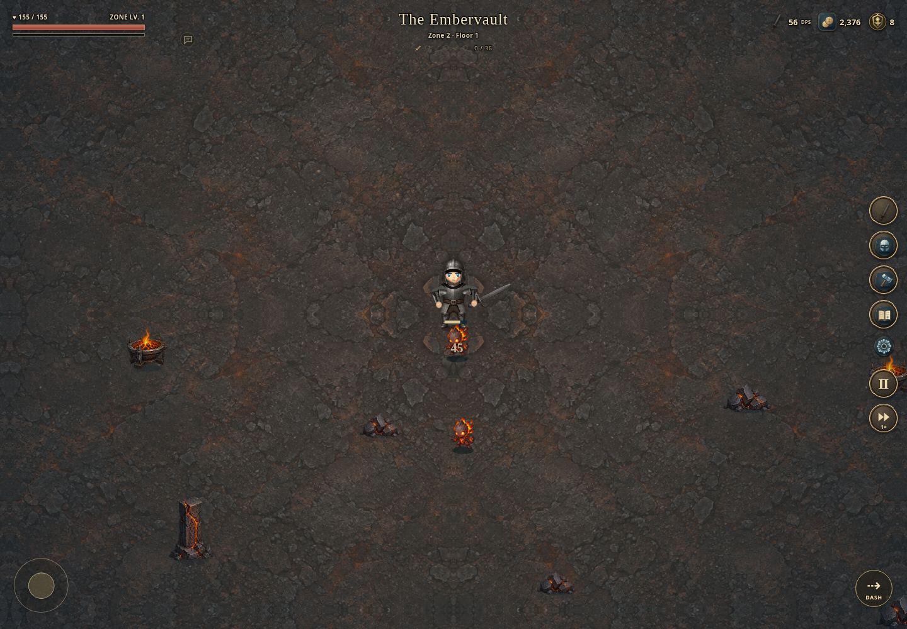

# Idle or Dungeoneer

**[Download the game (ZIP)](https://github.com/mefforts/idleordungeoneer/raw/refs/heads/main/downloads/Idle_or_Dungeoneer_Polished_v7.zip)** — extract the ZIP and open `index.html` in your browser.

Open **index.html** in a modern browser. The entire game, illustrations, creature sprites and icons are embedded in that file; playing needs no package installation or internet connection. `npm start` serves it locally with Python 3 if you prefer a consistent browser save origin.



[Minimal gameplay](polish-mobile-activity.png) · [Skills](polish-mobile-gather.png) · [Equipment](polish-equipment.png) · [Codex reading](polish-reading.png)

[Rig and weapon poses](preview-rig.png) · [Zone 2 gathering](preview-zone2.png) · [Tiered Skills](preview-tier-menu.png) · [Runestone UI](preview-runestones.png) · [Boss telegraph preview](preview-boss.png)

## Minimal presentation

Gameplay keeps the scene open: a circular work control shows progress, stock uses resource icons, and the rail carries the main actions. Skills rows show yield, cycle and stock without repeating instructions. Costs are source shortcuts, and a recipe bookmark follows you between activities. A missing skill or zone requirement takes precedence over a “Ready” message.

Books open readable Codex pages for skills, items, resources, recipes, permanent upgrades and power ranks. Closing a page returns to the same menu, search, recipe or unfinished power / Mastery choice. Item and recipe guides can be read before crafting; exploration discoveries still count separately. Detailed controls and save instructions are also in the Codex.

The first Delve begins with a short, non-blocking movement hint. Settings retains an optional tips tour. Defeat, floor-clear and unlock prompts state only the result and next action. Native buttons, keyboard focus, icon labels and short tooltips keep the compact controls usable. `npm run review:ui` captures the main desktop and mobile screens and records visible text / overflow checks in `presentation-audit.json`.

## Open gameplay HUD

The arena uses floating, outlined text and small isolated controls. Delve, Equipment, Skills, Codex, Settings, Pause and unlocked Game Speed use a vertical rail of circular icons; labels appear on hover or keyboard focus. In **Settings → Navigation**, choose the left or right side and reorder pins with touch-friendly arrows or by dragging a row. The layout is saved with your character.

The title and location sit at the top center. Health and XP remain on the left. Idle warnings and short notifications appear directly underneath; the small message icon opens **Messages** so you can read the last 40 notices. The menu palette uses warm stone, dark leather and brass. Buttons and headers are carved runestones with chipped bevels, stone grain and incised edge marks; selected controls have a warm amber inlay. Nine-slice SVG artwork preserves the edges at every screen size. Panels keep hard corners and gameplay pins remain circular. Station scenes fill portrait displays with a focused view of their artwork.

**Dungeoneering Mastery** replaces the Biome Mastery name. Its HUD shortcut displays the current dungeon’s **unspent mastery points**, and spending them updates that number. Essence remains a separate enchanting material.

Defeating the first guardian unlocks **1× / 2× Delve speed**. The existing testing code retains its higher combat speeds. **This changes combat only:** active gathering, crafting, bonus timing and idle production keep their own real-time clocks. Delve speed starts at 1× each launch.

## Experience and zone pacing

XP orbs no longer expire. Their positions and values survive Skills visits, deaths, retries, save/reload and returning to an earlier zone. Finishing an encounter collects the remaining XP automatically. Pending level-up choices also survive reload, and banking an orb cannot award it twice.

| Zone | Full-zone target at 1× | Intended single-target DPS |
| --- | --- | ---: |
| 1 | ~10 minutes | 81 (Iron reference) |
| 2 | ~20 minutes | 161 (Steel reference) |
| Later | Previous 30–40-minute targets | Current Steel reference; further progression reserved |

**Equipment** shows your worn set, current DPS, health, attack speed and range. Owned weapons display comparable DPS beside an Equip arrow. Armor and jewelry have separate tabs; Training can be expanded for each style’s proficiency and modifiers. The book icons open detailed rules and limits in the Codex. Iron ends at **100 permanent DPS** and Steel at **200 DPS** for a complete build. The weapon HUD also includes current damage, speed and critical powers.

Targets use continuous single-target attacking at normal Mastery pressure, before temporary powers. Menus, crafting, movement and deaths affect wall-clock time; cleaves, splash, offensive powers and faster game speed can shorten it. [BALANCE.md](BALANCE.md) documents the reference builds and every weapon’s attainable DPS; [balance-report.json](balance-report.json) contains the numbers.

## Active gathering and crafting

Hold the work button, hold the scene, or hold Space to work. After you start working, temporary bonuses appear in the scene:

- Iron/silver outcrops, oak offcuts and loose salvage award extra materials.
- Forge sparks, fletching twigs, aether glistens, rune motes and opal glints advance the active crafting cycle by **35%**.
- Tap a bonus, drag over it while holding, or focus it and press Enter/Space. A second finger can collect bonuses while the first keeps the work button held.
- Bonuses expire after six seconds. They do not spawn just because an idle task is running, cannot be collected twice, and never bypass recipe ingredients. Normal work continues without collecting them.

The **Skills** hub organizes each discipline into Gather, Refine, Equipment and Tools. Material costs show owned / required, missing ingredients link to their source, and tracked recipes follow you between stations.

Clear all three floors of **Zone 1** to unlock Tier 2 in every discipline. Gather / Refine has a resource-tier selector, and locked activities explain the required clear. The gate applies to active work, idle assignment and offline production. Each of the ten new activities supports bonuses, visible tools and a direct Idle button.

| Discipline | Zone 2 resources and recipes |
| --- | --- |
| Blacksmithing | Coal; 2 Iron Ore + 1 Coal → 1 Steel Bar |
| Woodworking | Willow Logs; 2 Willow + 1 Steel Bar → 12 arrows |
| Scavenging | Ancient Salvage; 2 salvage → 2 Ancient Fragments |
| Warding | 2 Warded Cloth + 1 Willow → 2 Runic Cloth; 2 Runic Cloth + 2 Ancient Fragments → 10 runes |
| Artisan | Rough Garnet → Cut Garnet |

Steel, willow, runic cloth, ancient fragments and cut garnets feed real armor recipes, promotions and further upgrades. All three styles use cut garnets when promoting. Coal, willow, ancient salvage and garnets have new, appropriate gathering environments. Existing opal jewelry remains available.

## Linked crafting

| Product | Base recipe |
| --- | --- |
| 8 arrows | 2 oak logs + 1 iron bar |
| 6 arcane runes | 2 warded cloth + 2 relic fragments |
| Iron Armor set | 10 bars + 2 cloth + 40 gold |
| Plain Ranger Leathers | 4 bars + 10 cloth + 6 logs + 40 gold |
| Plain Linen Robes | 2 bars + 18 cloth + 4 fragments + 40 gold |
| Iron pickaxe | 4 bars + 6 logs + 15 gold |
| Iron hatchet | 3 bars + 8 logs + 15 gold |
| Iron mattock | 5 bars + 6 logs + 20 gold |

Sets are crafted once and equipped explicitly. Reinforcement costs grow with each class’s own rank. Bows and staves use crafting materials to build the weapon; crafting them no longer consumes the ammunition you need to use them.

Improvised gathering tools remain available so you can gather the materials for a proper tool. Crafted tools equip automatically, appear on your character, provide **8% faster active gathering**, and add one material to each gathering bonus. Crafting stations provide their own visible hammer, knife, shuttle, stylus or polishing chisel.

Each station has **five upgrade levels**. Every level adds **2% ingredient conservation and 3% active/idle work speed**, up to 10% conservation and 15% speed. Conservation carries between crafts until a whole ingredient can be saved, avoiding fractional bars or fragments. Viewing a recipe does not consume that credit; only a successful craft does. Recipes show the exact current cost, and the station records ingredients saved.

## Weapons and actual armor sets

Only one weapon is wielded at a time. It selects your permanent Melee, Ranged or Magic combat profile. Each has independent refinement, speed, reach, enchantment and proficiency. Iron refinement ends at **10**; Steel at **20**. Each weapon’s damage curve reaches the same tier ceiling while retaining its own cooldown, reach and utility. Speed adds 2% and reach 3% per rank, capped at **5 ranks in Iron / 10 in Steel**. Reinforcement caps at 5 / 10 and enchantment at 2 / 4.

Finish Iron refinement 10, clear Zone 1 and reach crafting level 10, then pay for a **Steel promotion** in Skills → Equipment. It retains rank 10 and opens refinements 11–20 for that style only. Track the promotion to follow its material requirements back to the bench. Combat proficiency adds at most **3%** damage; crafting-skill levels 11–60 add at most **5%** more. Dedicated training therefore tops out near **108 / 216 DPS**. Temporary wave powers remain separate.

**Armor equips independently of weapons.** Craft a named set in Skills, then choose it in Equipment. Switching from a bow to a staff leaves your worn set and appearance intact. Owned sets and the selected outfit survive reload. Switching an owned set never heals you; newly crafting a set can grant its genuine increase in maximum health once.

| Class | Two available armor tiers | Crafting skill |
| --- | --- | --- |
| Warrior | Iron, Steel | Blacksmithing |
| Ranger | Plain, Cured leathers | Woodworking |
| Mage | Plain Linen, Blue Wool robes | Warding |

The tiers require skill levels **1 / 10**. Tier 2 also requires the Zone 2 unlock and new materials. Warrior sets favor health and damage reduction, Ranger outfits favor mobility, and Mage robes add 4% / 8% magic damage. Reinforcement adds **8 HP per rank**, limited by the worn set’s own tier. Later armor is unavailable in recipes, Equipment and the Codex.

All six existing weapon families use the illustrated Iron / Steel art, changing on a paid tier promotion. The rig uses per-weapon grip anchors, articulated elbows and separate hand layers. Halberds attach to their shafts with two aligned hands; greatswords have a support hand; bows draw and release; shields cover the grip hand. Weapon-specific swings stay forward of the face. Helmets are masked independently, and robe hems animate separately from boots. The same renderer handles combat, work scenes, Equipment and the character creator.

Old excess ranks and unavailable outfits are retained in `legacyProgressionArchive` / `archivedArmor`. Playable upgrades follow the new tier limits, and future outfits map to an available set of the same class. Promotions and selected outfits survive reload. Weapon changes do not switch armor, and every class can still use temporary elemental powers.

At your first 150-gold balance, a dismissible invitation suggests visiting Skills and crafting equipment.

## Dungeoneering threats and power ranks

Each floor overlord has **two telegraphed mechanics**: a projectile volley and marked ground strikes. The final overlord of a zone is substantially tougher, adds a **third locked-direction attack**, and attacks more often below 40% health. The warnings lock before striking, give time to move, pause with combat, and deal no damage until they resolve.

| Dungeon | Attack theme |
| --- | --- |
| Overgrowth | Green thorns, roots and a heartwood cleave |
| Embervault | Cinders, magma eruptions and furnace breath |
| Hollow Crypt | Violet souls, grave marks and a reaper’s gaze |
| Astral Rift | Cyan stars, rift collapses and astral severance |

After a boss has first appeared, a smaller elite echo can occasionally replace a wave enemy. There is at most one per wave, it counts toward completion, and it does not grant extra Mastery points or Essence.

Power cards show **Rank N**, the previous and next effects, and the improvement from the pick. A separate book button opens the full rank table without choosing the power. Number keys 1–3 still work without displaying shortcut numbers. Repeated picks strengthen the same power. Might is additive at 10 percentage points per rank (maximum +60%), Haste at 8 (maximum +48%), and critical chance rises by 8 per rank from 5% to a maximum of 45%. Extra projectiles deal 35% weapon damage. The higher zone targets and bounded bonuses make permanent training and repeat clears useful.

Burn now has visible flames and orange **Burn** damage numbers. Rank 1 burns for 10% of the triggering hit per second for 2.7 seconds; Rank 2 deals 20% per second for 3.4 seconds. Higher ranks further increase damage and duration. All powers have explicit rank limits and their totals appear in Equipment.

## Idle tasks

The warning **“Idle unlocks at Zone 1 · Floor 2”** stays visible until you clear Floor 1. Unlocking idle adds a **Select an idle task** action to the floor-clear screen and notice; it opens the Skills hub directly.

Every discipline hub and activity card has an **Idle** button. Press it to assign a free slot; press the same **Idle** button, marked with a stop icon, to stop it. The activity bar also has an Idle button. If both slots are occupied, a clear slot chooser asks which existing task to replace. No text dropdown is needed. Assigned tasks show progress and ingredient shortages, and the character works when you watch an assigned station.

The first slot opens at Zone 1, Floor 2; the second opens at Zone 10. Idle production continues while menus are open or you are delving, up to eight hours offline. Pausing an assignment keeps its partial progress.

## Controls and saves

| Action | Controls |
| --- | --- |
| Move | WASD, arrows, drag the arena, or touch joystick |
| Dash | Double tap a movement key / joystick direction, Space in combat, or Dash button |
| Active work | Hold work button / scene / Space; release to stop |
| Bonus collection | Tap, held-pointer drag, Enter or Space on a focused bonus |
| Skills / Equipment / Codex | G / E / C |
| Return to the delve | D or Delve pin |
| Close menu / pause combat | Escape |
| Choose a wave power | Click, Enter/Space, or 1–3 |

Existing saves and backups keep the `deepwell-prototype-v1` storage key. Former global upgrades migrate once to the independent profiles, subject to current tier limits; original excess investment is archived. Existing station boosts and production bonuses are retained. Settings includes backup/restore and reduced motion. Export your old save and restore it here if the files use different browser storage origins.

## Development and validation

Completed builds are delivered on GitHub with a playable ZIP in `downloads/`. Before pushing, review staged files for private data and credentials; exclude personal saves, local configuration and diagnostics. Verify that the downloadable ZIP contains the current standalone game. [AGENTS.md](AGENTS.md) records the delivery workflow.

Player-facing layouts and short labels live in `src/presentation.js` and `src/presentation.css`; readable reference pages and return navigation in `src/codex.js`; the appearance editor in `src/character-creator.js`. Core skill and resource definitions live in `src/game-data.json`; tier rules and render hooks in `src/zone-progression.js`; the articulated character rig in `src/avatar-rig.js`. Skills, HUD / XP and bosses remain in `src/systems.js`, `src/arena.js` and `src/dungeoneering.js`. Run `npm run build` to compile the source, styles and embedded art into the standalone HTML. The original combat engine remains in `index.html`.

```sh
npm ci
# If no system Chromium is installed:
npx playwright install chromium
npm run build
npm test
npm run report:balance
```

Nine suites use isolated browser storage and local servers. They cover **20 activities, four biomes and 104 distinct Codex icons**, saves, migration, exact recipes, conservation, tools, style isolation, real elemental attacks, touch / keyboard work, the actual Floor 1 idle unlock, direct idle assignment, and the gold milestone. Tier tests also check an actual Zone 1 completion, all six weapon ceilings against live damage / cooldowns, bounded training, paid promotion, thirty rig poses, every new activity and 320px layouts. Full-zone simulations verify pacing. Existing wave powers, biomes and jewelry remain guarded by a manifest.

The equipment sheets and their transparent gutters are packed by `scripts/export-equipment.py` using Pillow, NumPy and SciPy. It exports `src/equipment-art.json` and `src/equipment-regions.js`; those are embedded into the standalone game by the build. The original plain source sheets remain in the workspace’s generated-image folder, and ornate concepts are saved under `assets/equipment/concepts`.

Presentation tests cover the complete source → tracked recipe → craft loop, DPS refresh after outfit / skill changes, all 104 readable Codex entries, search and focus restoration, pending power choices, unapplied Mastery edits, and both rail positions from 320px phones to desktop.

Tests also verify all four boss themes, dodgeable telegraphs, elite gating and rewards, real touch double-tap dashes, exact burn stacking, independent armor persistence, and identical skilling output at 1×, 2× and 500× Delve speed.

Use `CHROMIUM_PATH` for a custom browser location. Test screenshots go to the ignored `test-results/` directory.
